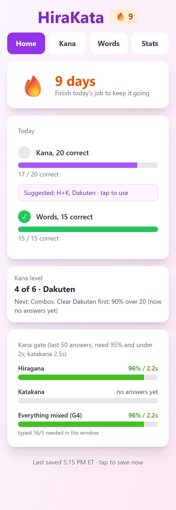
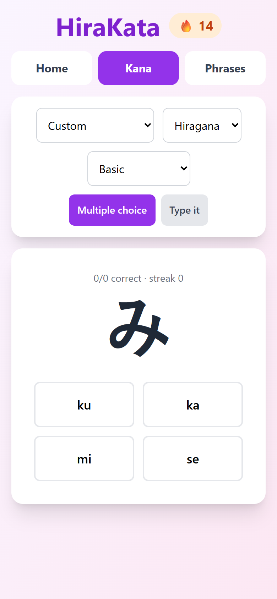
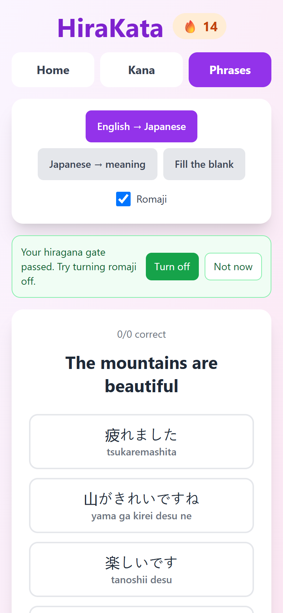

# HiraKata

  

A hiragana and katakana practice app I built with Claude Code while learning Japanese.

  

## Why I made it

I love anything to do with Japan, from anime to the cultural differences and similarities to the language itself. My goal is to become conversational in Japanese. HiraKata is one of the tools I use to practice the basics.

Initially I tried using Anki. It's a great tool that a lot of people vouch for, but the design feels a bit dated and I couldn't get into it. I also use Duolingo to practice but the constant ads make practicing more tedious. I wanted an ad-free alternative I could shape myself. So I figured while I'm starting out I'll practice the basics with a mobile app I can create and tailor to me, then move to Anki when I get deeper in the language learning journey for sentence structure and speech.

## What it does

- Practice two of the 3 main Japanese scripts in hiragana & katakana with their dakuten and handakuten counterparts.
- Lets me answer by multiple choice or by typing out each kana.
- Tracks how many I get right and wrong, and my overall accuracy.
- Uses a feature similar to Anki that assigns a weight to each kana based on the speed of my answer in addition to incorrect answers, so slow or missed kana come up more often.

  
  

## Tech stack

- Frontend: React, Vite, Tailwind CSS
- Backend: Cloudflare Pages Functions
- Database: Cloudflare D1
- Hosting: Cloudflare Pages

To run your own copy, see [SETUP.md](SETUP.md).

## What's next

I'm pairing this app with /teach, a popular Claude teaching skill from mattpocock/skills, to improve my Japanese before my next trip in 2027. Once I have a strong grasp of both kana I'll look to add helpful and commonly used words and phrases I'm trying to remember.
